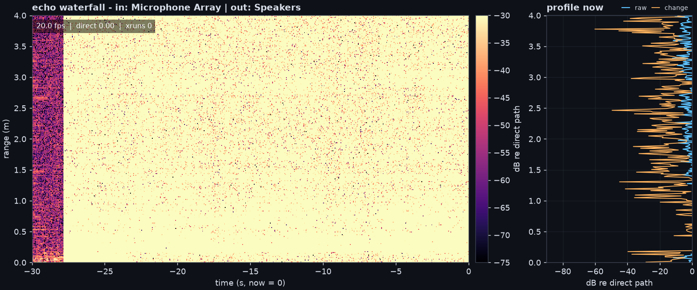

# echolocation

**Laptop-only sonar.** The speaker plays chirps, the built-in mic records the echoes, and a
small CNN works out **whether someone is there, how far away they are, and which room this is.**
No extra hardware.


<sub>Range-vs-time waterfall. Bright = echo energy that changed. A person walking 0.6 m → 3 m → 0.6 m draws a triangle.</sub>

## How it works

Every 50 ms the speaker plays a 20 ms sweep from 2 to 18 kHz. Playback and capture run in one
full-duplex stream, so the mic recording can be cross-correlated with the chirp. Each echo's
delay gives its distance, measured from the direct speaker→mic arrival. That produces one
range profile (0–4 m, 1.4 cm bins) per chirp. Background subtraction highlights what moved, and
EchoNet, a ~27k-parameter 1D CNN, predicts presence, distance and room from the profiles.

It only measures **range, not direction**: one speaker and one mic can't tell a wall 2 m ahead
from a cupboard 2 m to the left.

## Setup (Windows 11, native Python)

```powershell
uv venv .venv --python 3.11
uv pip install --python .venv\Scripts\python.exe numpy scipy sounddevice matplotlib pyyaml pytest opencv-python mediapipe
uv pip install --python .venv\Scripts\python.exe torch --index-url https://download.pytorch.org/whl/cpu
.venv\Scripts\Activate.ps1
python -m pytest                      # runs on the simulator, no hardware needed
python -m echo.camera download-model  # only for webcam auto-labels
```

Turn off Windows audio enhancements, noise suppression and voice focus for the mic and the
speakers. WASAPI exclusive mode is on by default and bypasses most of that processing. If you
are not sure, run `python -m echo.diagnostics linearity`.

## Usage

```powershell
# try it without hardware
python -m echo.live_waterfall --sim --sim-person walk     # also: none, static:1.5, wave, wander

# on the laptop
python -m echo.diagnostics timing --seconds 10            # ~200 chirps, low jitter, 0 xruns
python -m echo.calibrate --distance 0.50                  # book upright at 50 cm
python -m echo.live_waterfall                             # wave a hand at ~30 cm

# collect, train, run
python -m echo.collect --room desk --label empty --minutes 1
python -m echo.collect --room desk --label auto --camera --minutes 3   # webcam labels
python -m echo.train --name run1
python -m echo.evaluate --name run1
python -m echo.live_infer --name run1
```

Labels: `empty`, `walking`, `person_1.5m`, … or `auto --camera`. For camera labels, calibrate once
by standing 1.5 m away: `python -m echo.camera calibrate --distance 1.5`. Record on several days
and in 2+ rooms. Splits are by session or day, never by random frames.

## Results

**Real hardware (Acer Aspire 14 AI):** timing and linearity pass. The tool found 199 of 200
chirps, with direct-path jitter of 0.10 samples, and the noise floor at 1–3 m is −55 dB. Real
labelled sessions haven't been recorded yet.



**Simulator** (pipeline check, held-out day, not a real-world result):

| Task | Metric | Energy detector | Logistic / ridge | EchoNet |
|---|---|---|---|---|
| Presence | balanced accuracy | 52.9 % | 53.7 % | **88.7 %** |
| Distance | MAE | n/a | 0.250 m | **0.067 m** |
| Room ID (2 rooms) | accuracy | n/a | 100 % | 100 % |


## Limitations

* Range only, no direction (see above).
* The direct path swamps the first ~30 cm, and echoes beyond ~8.5 m alias into the next chirp.
* Moving the laptop shifts every static echo, so recalibrate and re-record after moving it.
* Someone who stays perfectly still slowly fades into the background.
* Windows audio processing can silently break it. Re-run `linearity` after updates.
* Simulator numbers say nothing about real accuracy.

## Layout

`echo/`: `audio_io` (duplex stream), `chirp`, `profile` (matched filter, range profiles),
`simulate`, `diagnostics`, `calibrate`, `camera` (pose labels), `collect`, `dataset`, `baselines`,
`model` (EchoNet), `train`, `evaluate`, `live_waterfall`, `live_infer`. Settings are in `echo/config.yaml`.
