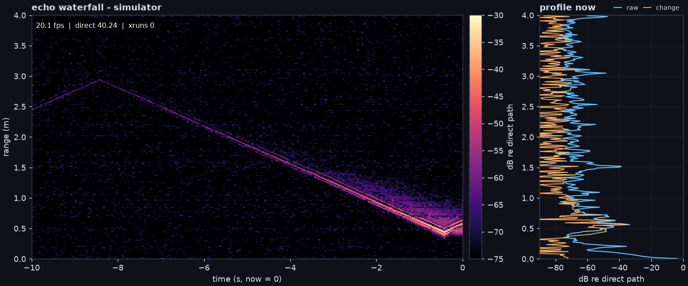
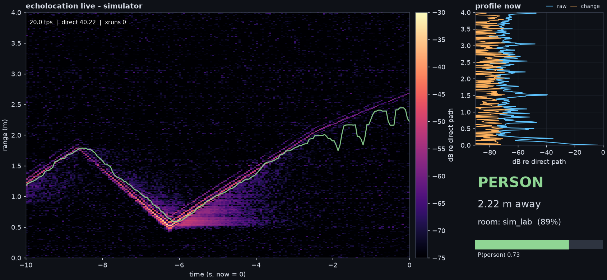
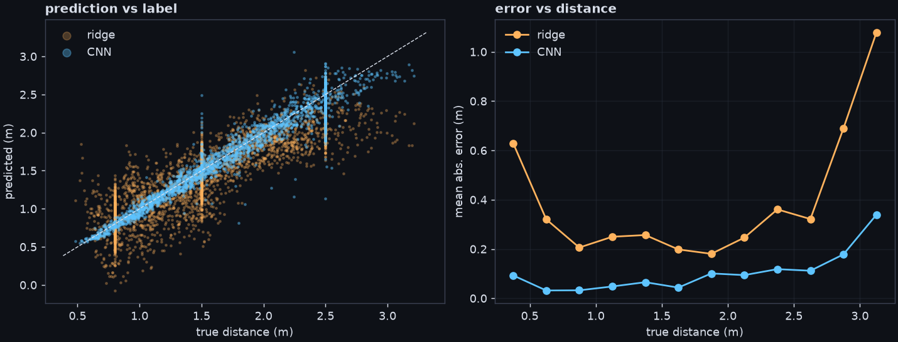
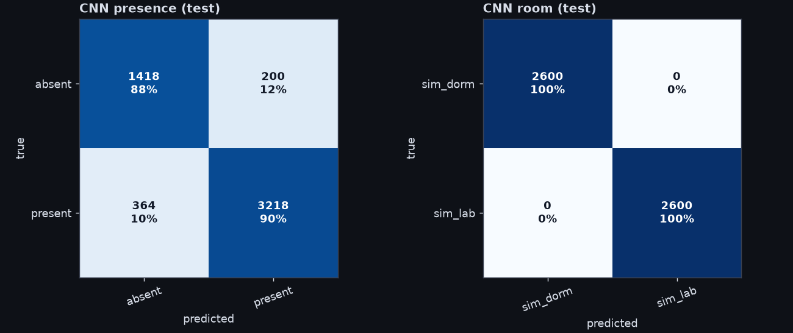
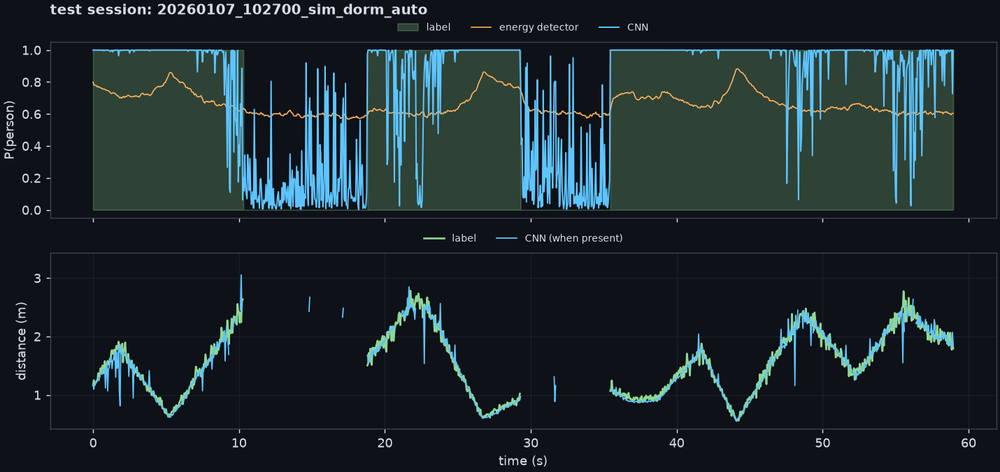

# echolocation

**Laptop-only sonar.** The speaker plays short ultrasonic-ish chirps, the built-in
microphone records the echoes, and a small CNN infers things about the room:
**is someone there, how far away, and which room is this.** No extra hardware.



<sub>Range-vs-time waterfall from the built-in simulator. Bright = echo energy that changed
against the background. A person walking 0.6 m → 3 m → 0.6 m draws a triangle.</sub>

> [!WARNING]
> **Do not run this loud, and never with your ear near the speaker.** Chirps are
> 2–18 kHz sweeps at 20 per second. Gain starts at **0.1 of full scale**, and
> `safety.max_gain` (0.3) cannot be exceeded without the explicit `--allow-loud`
> flag. Small laptop speakers can be damaged by sustained loud high-frequency
> content, so set the Windows volume to a moderate level and raise `--gain` only
> if echoes are too weak.

---

## How it works

```
 speaker ──chirp──▶ room ──echoes──▶ mic          (one full-duplex stream, one clock)
                                      │
             matched filter (cross-correlate with the chirp) → Hilbert envelope
                                      │
     lock onto the direct speaker→mic path; crop 0–4 m; 1 profile per chirp (20/s)
                                      │
      ┌───────────────────────────────┼───────────────────────────────┐
  live waterfall              background subtraction            features (3 ch)
                                (EMA, moving things            log profile, slow &
                                 stand out)                     fast change
                                                                      │
                                                         EchoNet (≈25k params, CPU)
                                                     presence · distance · room ID
```

* **Chirp** (`echo/chirp.py`): linear sweep 2 → 18 kHz, 20 ms, Tukey-tapered (no clicks),
  followed by 30 ms of silence: 50 ms period, 20 chirps/s.
* **Timing** (`echo/audio_io.py`): playback and capture share one PortAudio callback, so
  they share one sample clock. The unknown latency of the Windows audio stack is
  handled by locking onto the direct speaker→mic arrival, which is the strongest
  peak, and measuring every range relative to it. A calibration step removes the remaining
  fixed offset.
* **Range** (`echo/profile.py`): echo delay `d` samples → `d / 48000 × 343 / 2` m.
  One sample is 3.6 mm; profiles are average-pooled 4× to 1.4 cm bins, 280 bins for 0–4 m.
* **Model** (`echo/model.py`): a 1D CNN over range with three heads: presence (logit),
  distance (soft-argmax over a learned range map, so it is translation-equivariant and
  bounded), and room (classifier). Trained on CPU with 4 threads.

## Setup (Windows 11, native Python)

Use native Windows Python, **not WSL** (WSL audio passthrough adds latency and jitter).

```powershell
uv venv .venv --python 3.11
uv pip install --python .venv\Scripts\python.exe numpy scipy sounddevice matplotlib pyyaml pytest opencv-python mediapipe
uv pip install --python .venv\Scripts\python.exe torch --index-url https://download.pytorch.org/whl/cpu
.venv\Scripts\Activate.ps1
python -m pytest            # everything runs on the simulator; no audio hardware needed
```

Plain `python -m venv .venv` + `pip install -r requirements.txt` works too (install torch
from the CPU index as shown in `requirements.txt`).

For camera auto-labels, download MediaPipe's pose model once (about 5 MB, from Google's model storage):

```powershell
python -m echo.camera download-model
```

Always run modules with `python -m echo.<module>` from the repo root.

### Try it without any hardware

```powershell
python -m echo.live_waterfall --sim --sim-person wave          # a hand waving at 30 cm
python -m echo.live_waterfall --sim --sim-person walk          # someone walking around
python -m echo.sim_dataset --out data/sim_sessions --days 3    # synthetic multi-room dataset
python -m echo.train --data data/sim_sessions --name sim
python -m echo.evaluate --name sim
python -m echo.live_infer --name sim --sim --sim-person wander --sim-room sim_lab
```

`--sim-person` accepts `none`, `static:1.5`, `wave`, `linear:0.5:3:10`, `walk`, `wander`.

## Windows audio settings that matter

Windows and laptop vendors add "voice" processing that destroys sonar: automatic
gain control rescales the echoes, and noise suppression treats a steady chirp train as noise and
fades it out. **Turn all of it off before recording anything:**

1. **Settings → System → Sound → Input → your microphone → Properties:**
   *Audio enhancements* → **Off**. *Voice focus / Studio Effects* (Windows Studio Effects on
   Core Ultra NPUs) → **Off**.
2. **Settings → System → Sound → Output → your speakers → Properties:**
   *Audio enhancements* → **Off**, *Spatial sound* → **Off**.
3. **Classic panel** (`Win+R` → `mmsys.cpl`):
   * Recording → Microphone Array → Properties → *Enhancements*: tick **Disable all sound effects**;
     *Levels*: fixed level (~70–80), **Microphone Boost 0 dB**.
   * Playback → Speakers → Properties → *Enhancements*: **Disable all sound effects**.
   * *Communications* tab → **Do nothing** (stops ducking).
4. **Acer software:** AcerSense / **Acer PurifiedVoice** → AI noise reduction **Off**;
   Acer TrueHarmony / DTS / Dolby → **Off**.
5. **Realtek Audio Console / Intel Smart Sound** (if present): noise suppression, beamforming,
   echo cancellation → **Off**.
6. Close Teams / Zoom / Discord (they switch on echo cancellation for the shared device).

**WASAPI exclusive mode is on by default** (`audio.wasapi_exclusive: true`). It bypasses the
Windows mixer and the effects above. On the Acer Aspire 14 AI with the settings untouched,
shared mode let noise suppression erase the chirp within about 3 s (73 of 200 chirps found),
while exclusive mode found 199 of 200 and passed linearity. Exclusive mode needs the speakers and
mic to yourself: if another app is using them, the stream falls back to shared mode and prints a
warning. `timing` shows which mode it got (`[exclusive]` / `[shared]`).

`python -m echo.diagnostics linearity` tells you whether this worked (see below).

## Workflow

### 1. Audio I/O check

```powershell
python -m echo.audio_io list                       # devices; WASAPI ones are starred
python -m echo.diagnostics timing --seconds 10 --save-wav
python -m echo.diagnostics linearity
```

* Pick devices by name substring or id in `echo/config.yaml` (`audio.input_device`,
  `audio.output_device`); `null` uses the WASAPI defaults.
* **timing** should report about 200 chirps in 10 s, a direct-path jitter (99 % spread) of
  2 samples or less, and 0 xruns. `--save-wav` writes `capture.wav` / `playback.wav` to
  `debug/<timestamp>/`.
* **Clock drift.** On laptops the microphone (here an Intel Smart Sound array) and the speaker
  codec (Realtek) often run on separate crystals, so the direct path slides by a few ppm. That is
  harmless but adds up to tens of samples over a few minutes. The processor follows it, and
  `timing` reports it separately from jitter. Separately, the first ~1 s after the device opens
  is excluded from the jitter figure while the converters settle.
* **Double direct path.** The Acer shows a second arrival about 9 samples (0.2 ms) after the
  direct path at ~95 % of its strength, probably through the chassis or off the surface below.
  Alignment takes the *earliest* strong peak, so frames never flip between the two.
* **linearity** alternates gain *g* and *g/2* within one stream. A linear recording chain
  gives an amplitude ratio of 2.00 and no drift. AGC pulls the ratio towards 1, and noise
  suppression shows up as drift. On failure it prints a loud warning plus the settings list above.

### 2. Calibration and live waterfall

```powershell
python -m echo.calibrate --distance 0.50
python -m echo.live_waterfall
```

Calibration records the empty scene, then asks you to stand a **hard flat object (a book,
upright, facing the laptop)** at the given distance. It finds the book's echo in the
difference and writes `profile.calib_offset_samples` to `config.yaml`. Measure the distance
from the laptop's speaker/microphone edge.

In the waterfall, **wave your hand about 30 cm from the laptop**. A bright wavy band should
appear near 0.3 m (simulated version: `docs/waterfall_sim_handwave.png`). Press **s** to save a
screenshot to `docs/waterfall_live.png`.

### 3. Collect data

```powershell
# manual labels: one label for the whole session
python -m echo.collect --room dorm_desk --label empty       --minutes 1
python -m echo.collect --room dorm_desk --label person_1m   --minutes 2
python -m echo.collect --room dorm_desk --label walking     --minutes 2

# camera auto-labels: per-frame presence + distance from the webcam
python -m echo.camera calibrate --distance 1.5     # once: stand 1.5 m away, square to the camera
python -m echo.collect --room dorm_desk --label auto --camera --minutes 3

# compare sessions side by side
python -m echo.viz sessions data/sessions/<empty>.npz data/sessions/<walking>.npz --out docs/sessions.png
```

* Labels: `empty`, `person`/`walking` (presence only), `person_1m`, `person_1.5m`,
  `person_150cm` (presence + distance). Other labels (for example `--label desk`) are room-only sessions.
* Each session is written to `data/sessions/<id>.npz` (raw echo profiles, timestamps,
  presence, distance, direct-path amplitude and timing) plus `<id>.json` (room, device,
  gain, date, notes, label source, and a config snapshot).
* There is a 5 s countdown so you can leave the area. Ctrl+C stops early and still saves.
* **Record on several days and in at least 2 rooms.** Splits are by session, or by day when there
  are 3 or more days, never by random rows. Neighbouring frames are near-duplicates, so a
  random split would leak test data into training.

**Camera distance calibration.** MediaPipe Pose gives shoulder and hip landmarks. A pinhole
camera sees an object of width *W* at distance *d* as *w = f·W/d* pixels wide, so
*d = K / w* with *K = f·W*. `camera calibrate` measures *K* from your median shoulder width
in pixels at a known distance, plus the torso-height/shoulder-width ratio when your hips are
in frame. At run time the code takes the **smaller** of the shoulder- and torso-based
estimates, because turning sideways or partial occlusion only ever makes a body part look
smaller (farther). Audio frames and camera frames are both stamped with
`time.monotonic()`, and each audio frame takes the nearest camera sample within 0.25 s.
*K* is specific to your body and camera; recalibrate for another person.

### 4. Train and evaluate

```powershell
python -m echo.train --name first_run            # CPU, 4 threads, checkpoint every epoch
python -m echo.train --name first_run --resume   # continue after a crash
python -m echo.evaluate --name first_run
```

`evaluate` fits the baselines on the same training sessions, scores everything on the
held-out sessions, prints the results table and writes `results.md`, `metrics.json`,
`confusion.png`, `distance_error.png` and `timeline.png` to `runs/<name>/`.

Training is kept light on purpose: under 100k parameters, `torch.set_num_threads(4)`
(`--threads 2` for even less), a short pause between epochs, and atomic checkpoints, so a
crash never corrupts `last.pt`.

### 5. Live demo

```powershell
python -m echo.live_infer --name first_run
```

Waterfall + current profile + a readout: **PERSON / EMPTY**, distance, room, and
P(person). The predicted distance is drawn over the waterfall in green. Presence uses
hysteresis (on above 0.6, off below 0.4) so the display does not flicker.

## Results

### Hardware bring-up (Acer Aspire 14 AI, laptop on a nightstand)

| Check | Gain 0.1 | Gain 0.3 |
|---|---|---|
| Chirps found in 10 s | 197 / 200 | 199 / 200 |
| Direct-path jitter (std) | 0.24 samples | 0.10 samples |
| Clock drift (mic vs speaker) | a few ppm, tracked | a few ppm, tracked |
| Linearity (hi/lo ratio, expected 2.00) | 1.99 / 1.97 / 2.00, drift 1.1 % | – |
| Frame-to-frame noise floor, 1–3 m | −46 dB re direct | **−55 dB** re direct |

All numbers are with WASAPI exclusive mode and the Windows volume at 42 %. Higher gain lowers the
noise floor by the full 9.5 dB, which matters: a person at 1–2 m echoes at roughly −40 to −50 dB.
**Use `--gain 0.3` for collection and the live demo** if the chirp is tolerable in your room.


### Real recordings

*Not recorded yet.* Collect sessions (see the checklist below), then run
`python -m echo.train --name real && python -m echo.evaluate --name real` and paste
`runs/real/results.md` here.

| Task | Metric | Energy detector | Logistic / ridge | EchoNet CNN |
|---|---|---|---|---|
| Presence | balanced accuracy | – | – | – |
| Distance | MAE (m) | n/a | – | – |
| Room ID | frame accuracy | n/a | – | – |

### Simulator (pipeline check, not a real-world result)

`python -m echo.sim_dataset --days 3` → 30 sessions in 2 simulated rooms across 3 "days".
Split **by day**: train and validation on days 1–2, **test on a held-out day** (10 sessions, 5,200 frames).
Every number is on the held-out day; baselines and CNN see exactly the same training sessions.

| Task | Metric | Energy detector | Logistic / ridge | EchoNet CNN (27k params) |
|---|---|---|---|---|
| Presence | balanced accuracy | 52.9 % | 53.7 % | **88.7 %** |
| Presence | AUROC | 0.544 | 0.677 | **0.942** |
| Distance (person present) | MAE | n/a | 0.250 m | **0.067 m** |
| Distance (person present) | within 25 cm | n/a | 58.1 % | **95.7 %** |
| Room ID (2 rooms) | frame accuracy | n/a | 100 % | 100 % |

**Does the CNN beat the baselines?** On this held-out simulated day, yes for presence
and distance. Room ID is a tie: the two simulated rooms have very different static
echoes, so even a linear model separates them perfectly.

**Why the baselines are weak here.** The energy detector only sees *change*. Nearly half of the
"present" frames come from people standing still at fixed distances, and to a change
detector a still person looks like an empty room, so it sits near chance. That is a real limitation
of change-based presence detection, not a bug. The linear model has the raw profile but
must learn "something new at an unknown range" with one weight per range bin, which does
not generalise across days in which furniture moved slightly. The CNN is
translation-equivariant along range and compares against its own background channels.

<p>
  
</p>

| | |
|---|---|
|  |  |



Expect real recordings to be noticeably worse: see Limitations.

## Limitations (honest)

* **Single microphone, no direction.** One mic gives range only. A person at 1.5 m to the
  left and a cupboard at 1.5 m to the right land in the same bin. Laptop mic arrays usually
  reach applications as one pre-mixed channel.
* **Speaker roll-off above about 16–18 kHz.** Laptop speakers and their DSP roll off hard at the top
  of the sweep, so the effective bandwidth (and range resolution, about c/2B) is worse
  than the nominal 16 kHz suggests. Expect ~2–4 cm resolution, not 1 cm.
* **Direct-path dominance.** The speaker→mic path through the chassis and air is 30–60 dB
  stronger than any echo. Its sidelobes and ringing swamp the first ~20–30 cm, which is
  why the baselines ignore < 0.3 m and the waterfall's bottom rows are noisy.
* **Reverb and the 50 ms period.** Echoes from more than ~8.5 m (about 50 ms round trip) alias into the next
  period. Live rooms with hard walls have a long diffuse tail that shows up as a
  static floor. Background subtraction removes most of it, unless something else in the room moves.
* **Sensitivity to placement.** Moving the laptop a few centimetres, or opening the lid
  further, shifts every static echo. A model trained in one placement may not transfer to another.
  Room ID in particular learns the placement as much as the room. Recalibrate and record
  new sessions after moving the laptop.
* **Still people fade.** Background subtraction (and the energy baseline) only sees change.
  A person who sits perfectly still slowly becomes "background". The CNN also sees
  the raw profile and a 5 s slow background, which helps, but long still periods remain hard.
* **Windows audio processing.** AGC, noise suppression and "voice focus" can silently
  break everything. Re-run `diagnostics linearity` after driver or Windows updates.
* **Camera labels are approximate.** Pinhole distance from shoulder width is about ±10–15 %,
  depends on posture, and measures distance from the *camera*, which sits a few cm from the
  speaker and mic.
* **Simulated results are not real results.** The simulator is idealised (point
  scatterers, white noise, no speaker distortion). Use it to check the pipeline, not
  to predict accuracy.

## Physical steps checklist

Steps marked ✅ were done on the Acer (see *Hardware bring-up* above). The rest need a person
in front of the laptop:

1. ✅ Devices: `python -m echo.audio_io list`. Input pinned to "Microphone Array" (not Stereo Mix).
2. ✅ `python -m echo.diagnostics timing --seconds 10 --save-wav`: PASS in exclusive mode.
3. ✅ `python -m echo.diagnostics linearity`: PASS. Re-run after driver or Windows updates.
4. ✅ `python -m echo.camera download-model`; the webcam and pose model run at ~15 fps.
5. `python -m echo.calibrate --distance 0.50` with a book.
6. `python -m echo.live_waterfall --gain 0.3`. Wave a hand at about 30 cm, press **s** for a screenshot.
7. `python -m echo.camera calibrate --distance 1.5`, standing square to the camera.
8. Record a 1-minute `empty` session and a 1-minute `walking` session (or `auto --camera`),
   then `python -m echo.viz sessions ...` to compare them.
9. Collect more data: several days, 2+ rooms, empty, still at known distances, walking. Then train and evaluate.

## Repository layout

```
echo/
  config.yaml        sample rate, chirp, gain + safety ceiling, devices, range, calibration
  config.py          typed config loader, gain safety, in-place YAML updates
  audio_io.py        device listing (WASAPI first), full-duplex stream, raw WAV dumps
  chirp.py           windowed sweep, periodic player
  profile.py         matched filter, envelope, delay<->metres, streaming processor, EMA background
  simulate.py        synthetic echoes, rooms, moving people, simulated duplex stream
  sonar.py           one interface over hardware and simulator, shared CLI flags
  diagnostics.py     timing/jitter and linearity checks (Stage 1 acceptance)
  calibrate.py       book-at-known-distance calibration
  viz.py             plotting helpers, side-by-side session waterfalls
  live_waterfall.py  real-time waterfall (~20 fps)
  camera.py          MediaPipe pose → presence/distance auto-labels, camera calibration
  collect.py         labelled session recorder
  sim_dataset.py     synthetic multi-room, multi-day dataset
  dataset.py         session I/O, session/day splits, causal features, augmentation
  baselines.py       energy-change detector, logistic/ridge regression
  metrics.py         dependency-free metrics
  model.py           EchoNet
  train.py           training with per-epoch checkpoints and resume
  evaluate.py        held-out metrics, baseline comparison, plots
  live_infer.py      live demo with predictions
tests/               pytest suite, simulator only
docs/                screenshots and result plots
```

## Configuration notes

* `chirp.gain` is the playback level (fraction of full scale). `safety.max_gain` is the
  ceiling. `--gain` overrides per run, and `--allow-loud` is required above the ceiling.
* `profile.max_range_m` (4 m) must fit within one period. The config loader refuses
  combinations where echoes from consecutive chirps would overlap.
* `profile.align: direct` re-aligns every frame on the direct path (robust to jitter).
  `fixed` locks once (use it to see raw jitter).
* `profile.background_alpha` controls how fast the waterfall forgets: higher means only fast motion shows.
* `train.*`: epochs, batch size, learning rate, threads, split fractions, augmentation
  (noise, ±2 dB gain, ±2-bin delay jitter).
